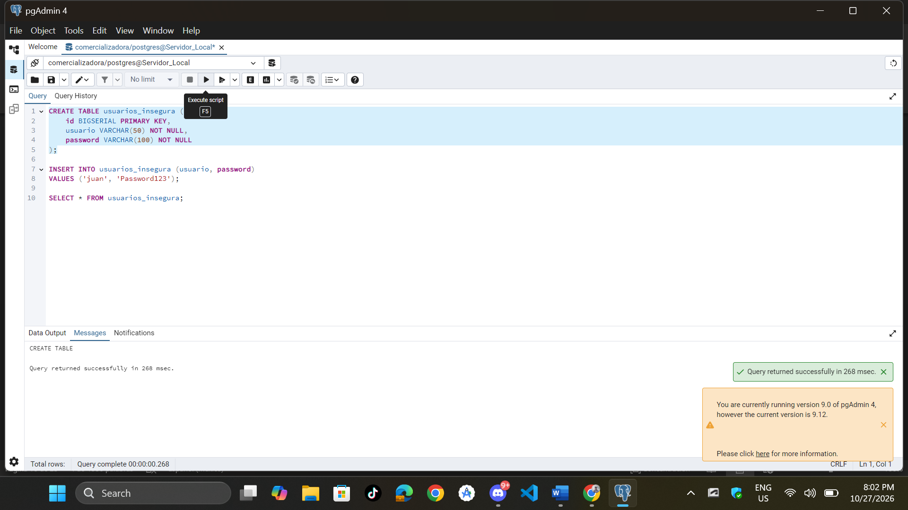
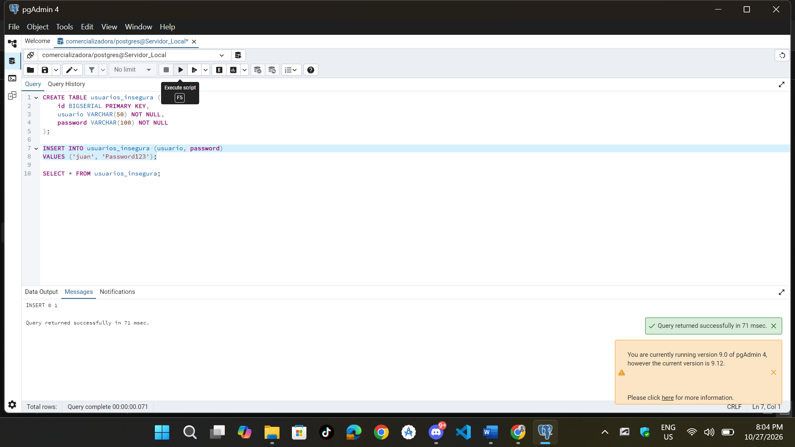
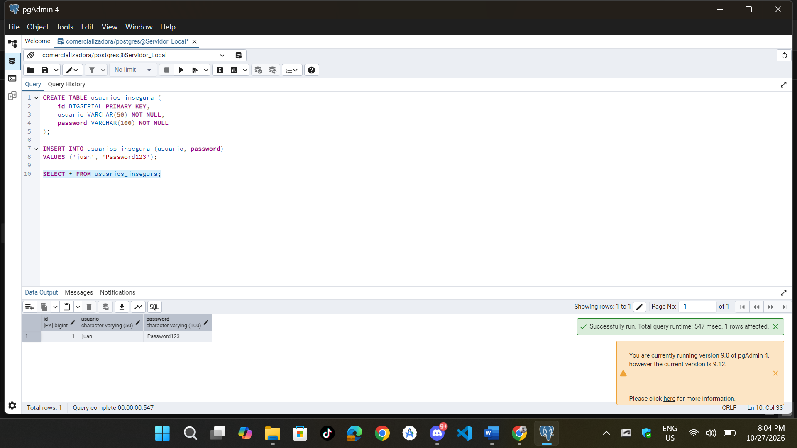
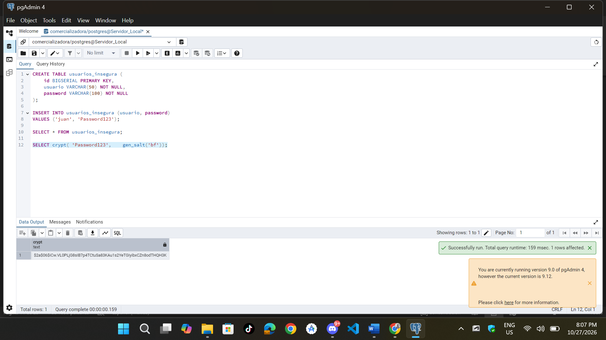
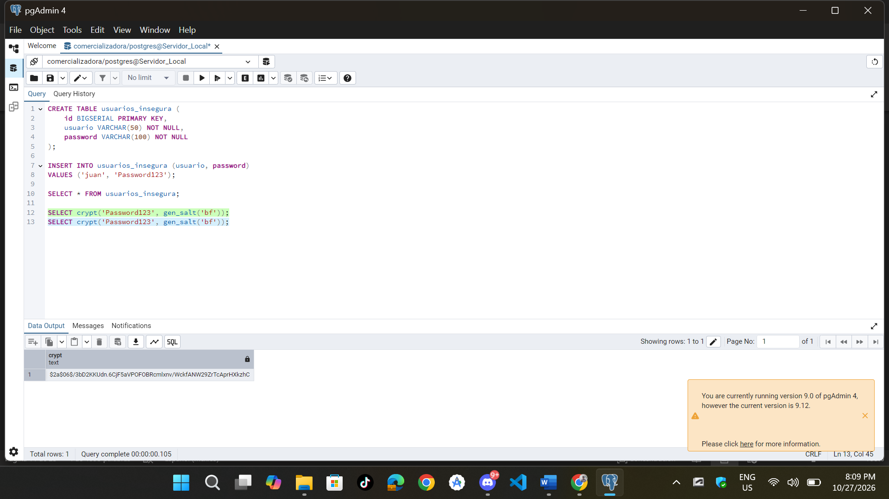
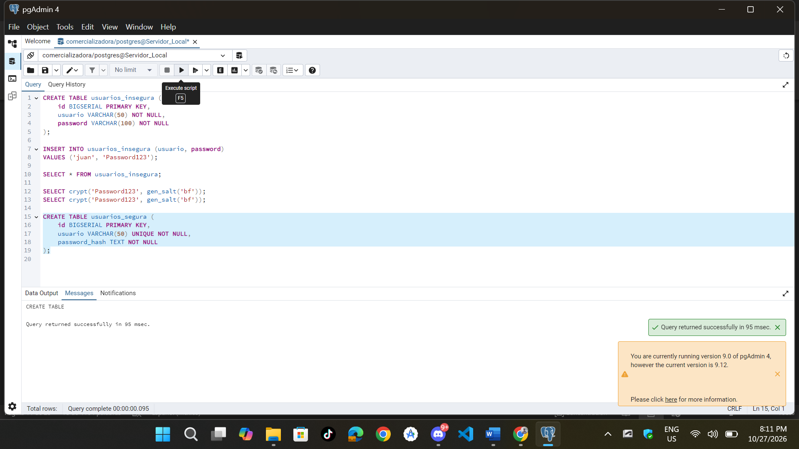
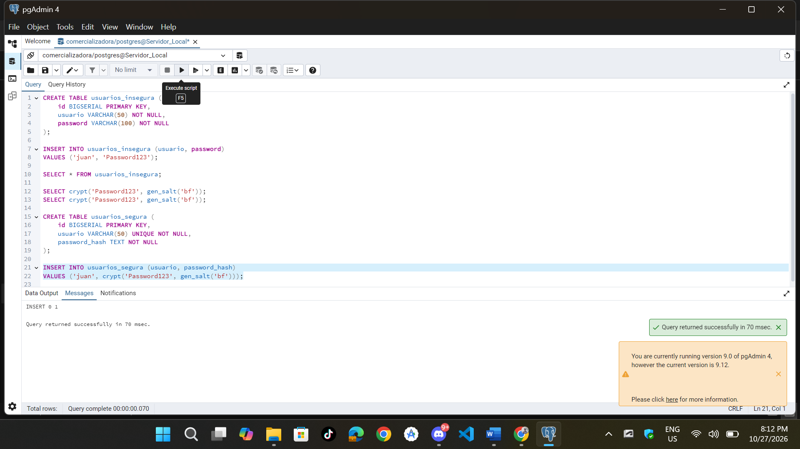
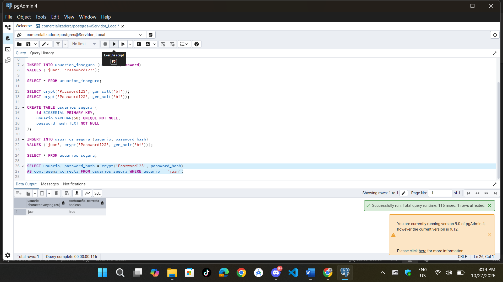
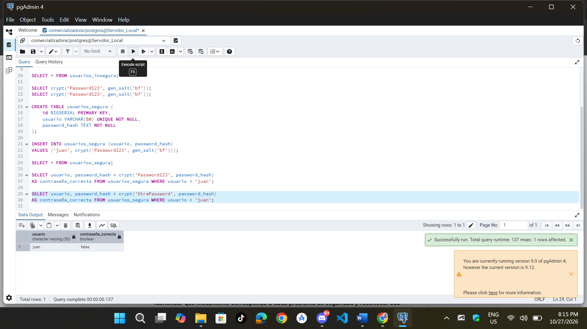

**Actividad 1 — Protección de Credenciales**

```sql
-- Creacion de la tabla insegura
CREATE TABLE usuarios_insegura (
    id BIGSERIAL PRIMARY KEY,
    usuario VARCHAR(50) NOT NULL,
    password VARCHAR(100) NOT NULL
);
```


```sql
-- Insertamos datos
INSERT INTO usuarios_insegura (usuario, password)
VALUES ('juan', 'Password123');
```


```sql
-- Realizamos la consulta
SELECT * FROM usuarios_insegura;
```


```sql
-- Usamos pgcrypto para hashing seguro
SELECT crypt('Password123', gen_salt('bf'));
SELECT crypt('Password123', gen_salt('bf'));
```



```sql
-- Creacion de la tabla segura
CREATE TABLE usuarios_segura (
    id BIGSERIAL PRIMARY KEY,
    usuario VARCHAR(50) UNIQUE NOT NULL,
    password_hash TEXT NOT NULL
);
```


```sql
-- Insertamos un dato a esa tabla
INSERT INTO usuarios_segura (usuario, password_hash) 
VALUES ('juan', crypt('Password123', gen_salt('bf')));
```


```sql
-- La consultamos
SELECT * FROM usuarios_segura;
```


```sql
-- Verificamos la autenticacion con el password correcto
SELECT usuario, password_hash = crypt('Password123', password_hash)
AS contraseña_correcta FROM usuarios_segura WHERE usuario = 'juan';
```


```sql
-- Verificamos la autenticacion con el password incorrecto
SELECT usuario, password_hash = crypt('OtraPassword', password_hash)
AS contraseña_correcta FROM usuarios_segura WHERE usuario = 'juan';
```


#### Preguntas

* **¿Qué ocurriría si una persona obtiene acceso de lectura a la tabla?**
    
    Obtendría inmediatamente todas las contraseñas de los usuarios, permitiendo la suplantación de identidad.

* **¿Son iguales?, Si no son iguales, ¿por qué?**
    
    No, ya que generan texto completamente distintos.

* **¿Qué función cumple gen_salt()?**

    Genera un valor aleatorio específico para el algoritmo indicado , asi evitando que contraseñas idénticas produzcan hashes idénticos.

* **¿Qué función cumple crypt()?**

    Aplica un algoritmo criptográfico unidireccional de derivación de clave para transformar la contraseña en un hash no invertible combinándolo con la sal.

* **¿Esto es cifrado reversible?**

    No, ya que no existe un mecanismo para descifrar la contraseña original a partir del hash.

* **¿Qué resultado obtuviste con la contraseña correcta?, ¿Qué resultado obtuviste con la contraseña incorrecta?**

    Con la contraseña correcta el resultado booleano es `true`, mientras que con la incorrecta es `false`.

* **¿Por qué no es necesario recuperar la contraseña original?**

    Porque el proceso de autenticación sólo necesita verificar si el valor que se ingreso, al ser pasado por la misma función sal, se obtiene exactamente el mismo hash.

* **¿Por qué un hash no debe confundirse con cifrado?**

    El hash es **unidireccional** e irreversible (diseñado para autenticar sin revelar el secreto). El cifrado es **bidireccional** y reversible (diseñado para proteger un dato que eventualmente debe ser leído en texto claro usando una clave).