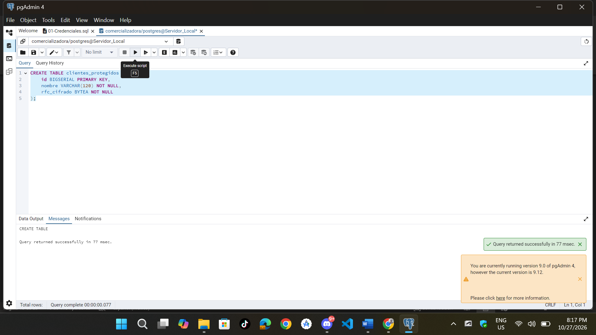
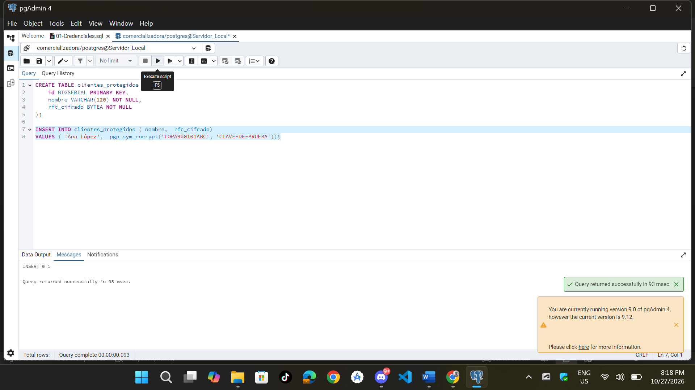
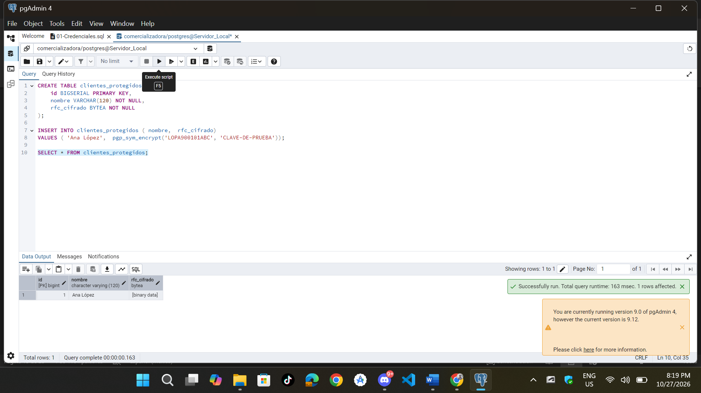
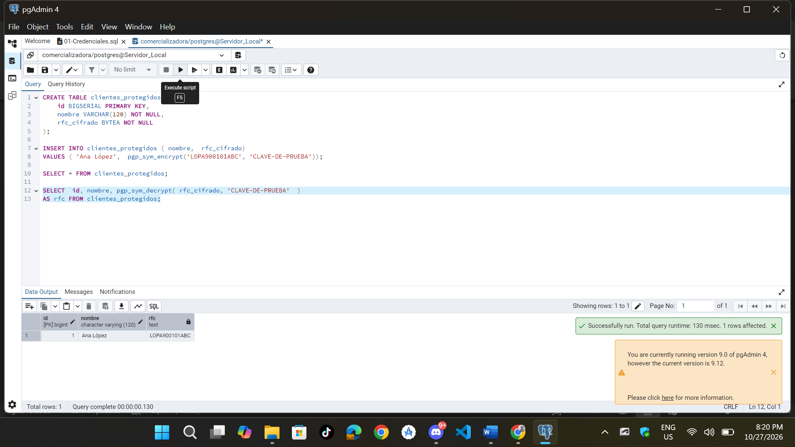

**Actividad 2 — Cifrado de Información Sensible**

```sql
-- Creacion de la tabla de clientes
CREATE TABLE clientes_protegidos ( 
	id BIGSERIAL PRIMARY KEY,
	nombre VARCHAR(120) NOT NULL,
	rfc_cifrado BYTEA NOT NULL
);
```


```sql
-- Insertamos un dato con cifrado
INSERT INTO clientes_protegidos ( nombre,  rfc_cifrado) 
VALUES ( 'Ana López',  pgp_sym_encrypt('LOPA900101ABC', 'CLAVE-DE-PRUEBA'));
```



```sql
-- Consultamos la tabla
SELECT * FROM clientes_protegidos;
```


```sql
-- Desciframos el dato
SELECT  id, nombre, pgp_sym_decrypt( rfc_cifrado, 'CLAVE-DE-PRUEBA'  ) 
AS rfc FROM clientes_protegidos;
```


#### Preguntas

* **¿Qué diferencia existe entre crypt() y pgp_sym_encrypt()?**

    `crypt()` genera un hash unidireccional no el cual no es reversible para las contraseñas. Mientras que `pgp_sym_encrypt()` realiza cifrado simétrico reversible el cual utiliza una clave secreta para recuperar el dato original.

* **¿Cuál de los dos mecanismos permite recuperar el dato original?**

    `pgp_sym_encrypt()` mediante `pgp_sym_decrypt()`.

* **¿Qué ocurre si se utiliza una clave incorrecta?**

    Se genera un error de ejecución notificando que la clave es incorrecta, asi impidiendo el acceso a la información.

* **¿Qué problema de seguridad representa colocar la clave directamente en una consulta?**

    Expone la clave en el historial de comandos, en el código de la aplicación y en capturas de pantalla.