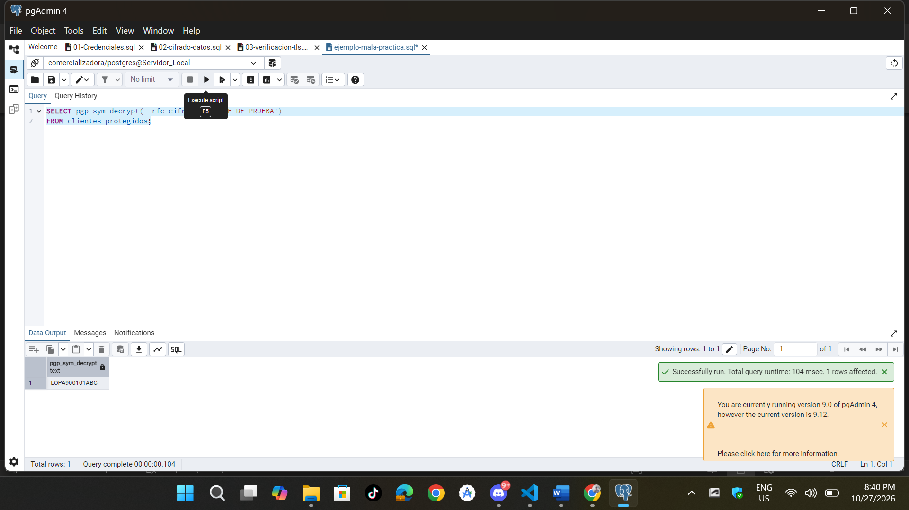

**Actividad 3 — El Problema de la Gestión de Claves**

#### 2. Análisis del Archivo Inseguro (`sql/ejemplo-mala-practica.sql`)

```sql
-- Ejemlplo de mala practica
SELECT pgp_sym_decrypt(rfc_cifrado, 'CLAVE-DE-PRUEBA') FROM clientes_protegidos;
```


#### Preguntas

**¿Qué ocurriría si esta clave fuera una clave utilizada realmente por una organización y el archivo se publicara en un repositorio Git?**

    Cualquier persona que tenga acceso al repositorio podría extraer la clave desde el historial de commits. Y con esa clave y acceso a la base de datos, podrían descifrar toda la información confidencial de la empresa.