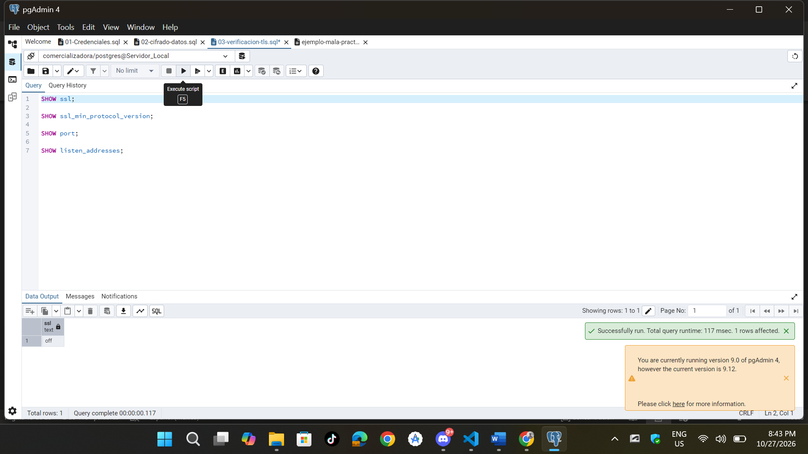
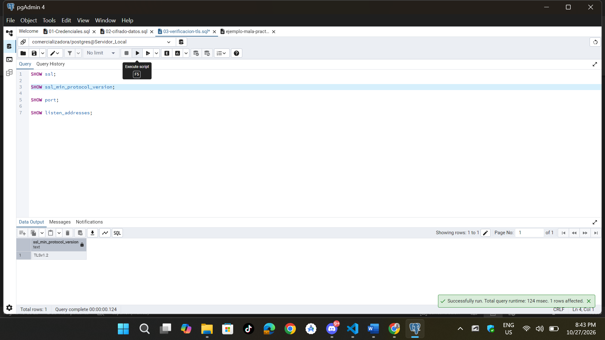
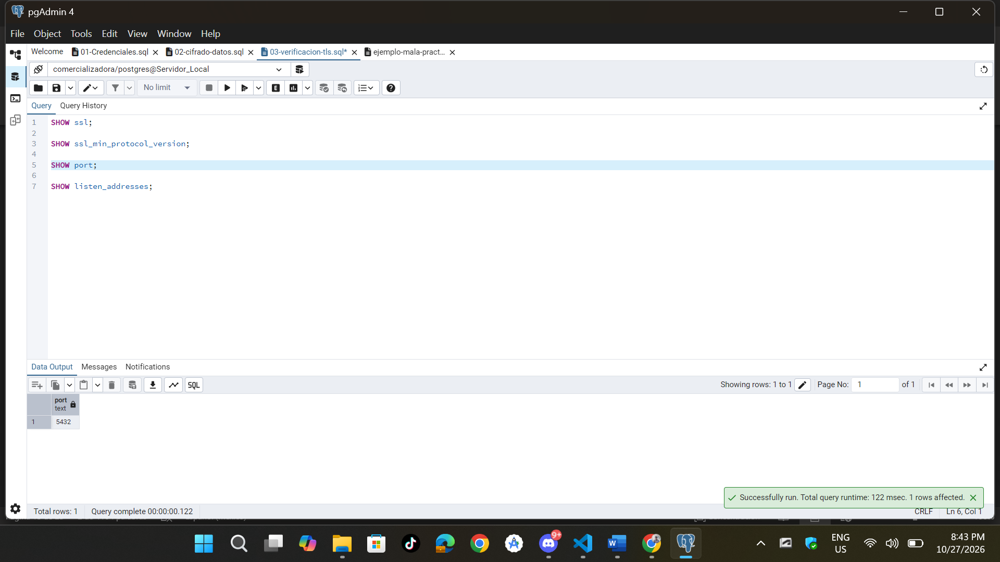
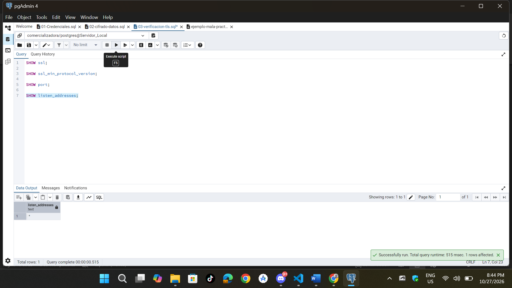
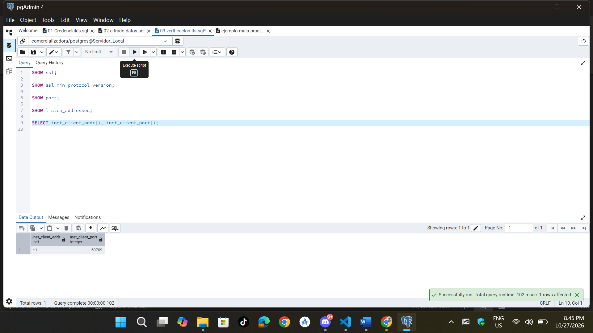
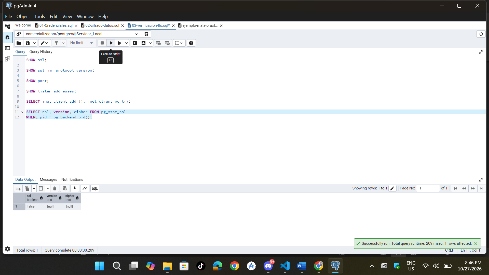

**Actividades 4, 5 y 6 — Protección de Datos Durante la Comunicación (TLS)**
#### 2. Comandos de Verificación

```sql
-- Parámetros del servidor
SHOW ssl;
SHOW ssl_min_protocol_version;
SHOW port;
SHOW listen_addresses;
```





```sql
-- Verificamos la sesion actual
SELECT inet_client_addr(), inet_client_port();

SELECT ssl, version, cipher 
FROM pg_stat_ssl 
WHERE pid = pg_backend_pid();
```




#### Preguntas

* **¿La conexión actual utiliza TLS?**

    No, actualmente mi equipo no esta utilizando conexion TLS.

* **¿Qué versión de TLS se está utilizando?**

    Mi equipo actualmente no esta utilizando TLS.

* **¿Qué algoritmo de cifrado aparece?**

    No nos arroja ninguna.

* **¿Qué diferencia existe entre una conexión protegida con TLS y una sin TLS?**

    La conexión con TLS cifra todo el tráfico en tránsito entre el cliente y el servidor, garantizando confidencialidad, integridad y autenticación. Una conexión sin TLS envía el tráfico en texto claro.